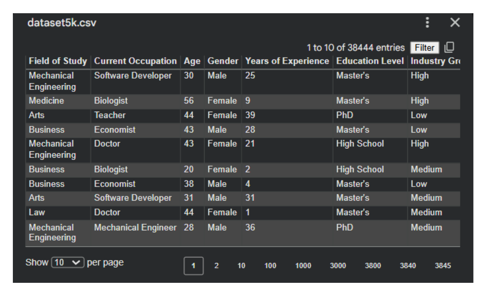
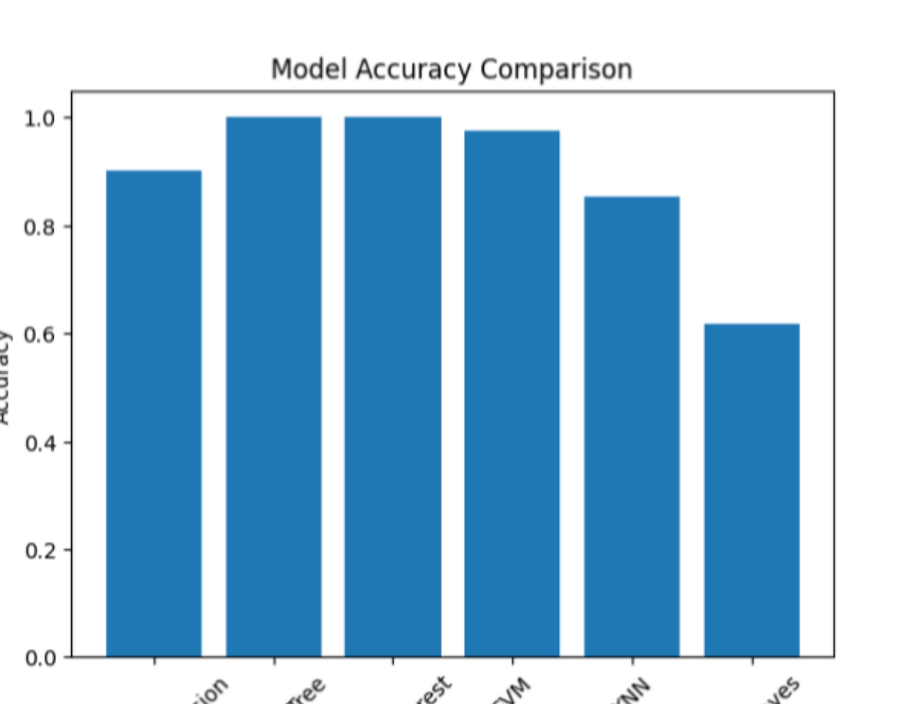
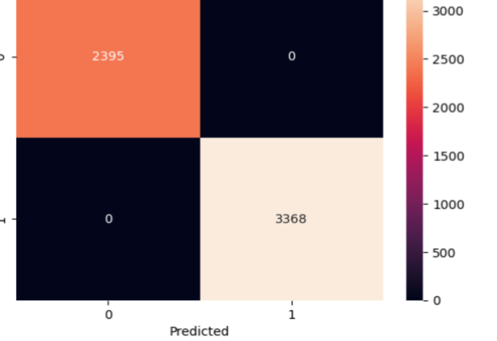
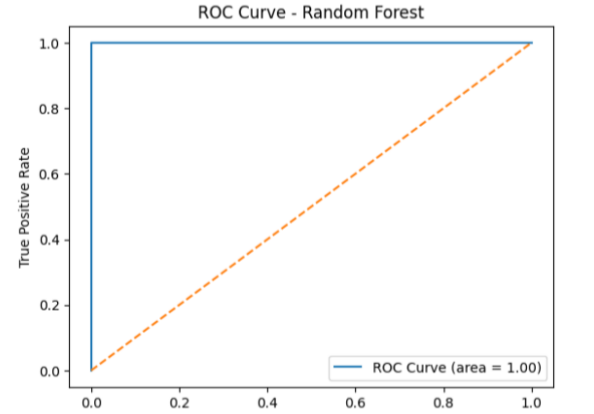
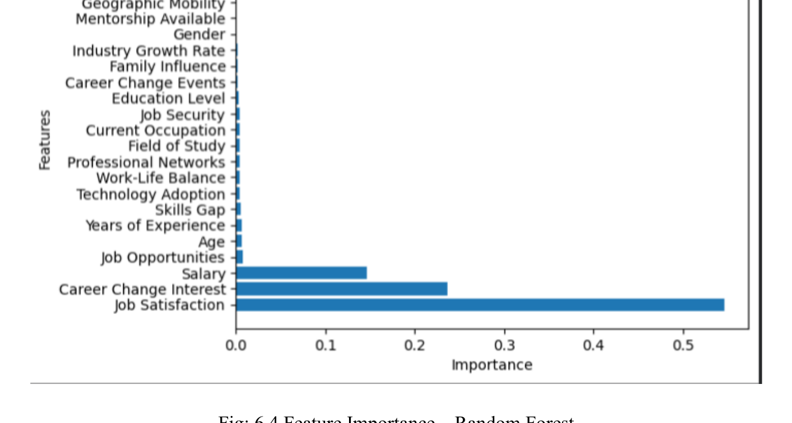
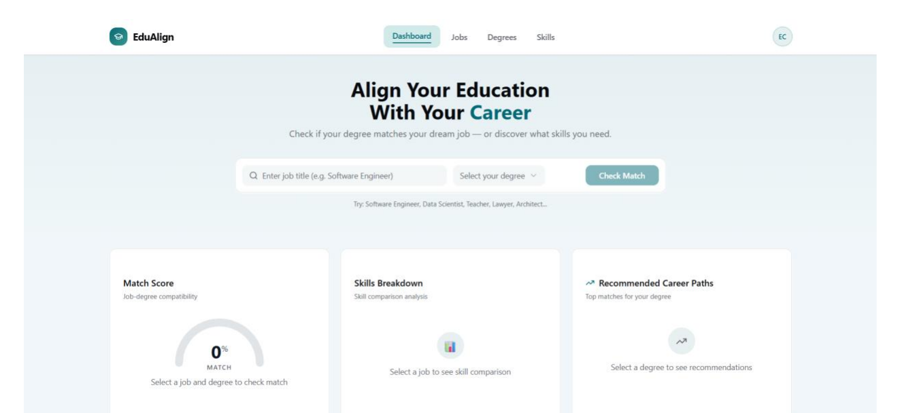
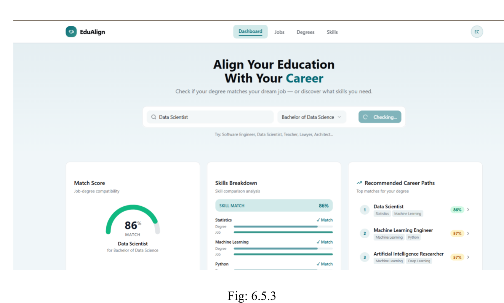

# Bridging the Gap Between Education and Industry
## A Machine Learning-Based Study of Career Change


A machine learning study of **education–employment mismatch**: how a person's
education, skills, experience and current-job attributes relate to whether they
are **likely to change occupation**. Six classification algorithms are trained and
compared, and the factors that drive occupational mobility are ranked by feature
importance. A companion dashboard prototype ("EduAlign") that matches a degree to
a job is documented as a separate component.

> **An honest note on results.** The original dataset file is not available, so
> the models could not be re-run for this repository. Every result below is
> labelled by its source — *documented run output* (the actual program outputs
> printed in the academic report) or *as reported in Chapter 6* (a narrative table
> that conflicts with those outputs). The report also contains several internal
> inconsistencies; they are documented openly in
> [PROJECT_REVIEW.md](PROJECT_REVIEW.md) rather than hidden.

---

## Table of Contents
1. [Project Overview](#project-overview)
2. [Problem Statement](#problem-statement)
3. [Research Objectives](#research-objectives)
4. [Dataset](#dataset)
5. [Target Variable](#target-variable)
6. [Features](#features)
7. [Technologies and Libraries](#technologies-and-libraries)
8. [Machine Learning Algorithms](#machine-learning-algorithms)
9. [Data Preprocessing Workflow](#data-preprocessing-workflow)
10. [Model Training Methodology](#model-training-methodology)
11. [Evaluation Metrics](#evaluation-metrics)
12. [Model Results](#model-results)
13. [Visualisations](#visualisations)
14. [Dashboard Prototype](#dashboard-prototype)
15. [Project Structure](#project-structure)
16. [Installation](#installation)
17. [How to Run](#how-to-run)
18. [Limitations](#limitations)
19. [Future Improvements](#future-improvements)
20. [Author and Academic Information](#author-and-academic-information)

## Project Overview

Education is expected to prepare graduates for jobs aligned with their field of
study, yet in India many graduates work in occupations unrelated to their
qualifications or change occupations as they search for a better fit. This project
applies predictive modelling to that problem: given a person's educational
background, skills and current-job attributes, it predicts the likelihood of an
occupational change and identifies which factors influence it most.

## Problem Statement

There is a measurable gap between academic qualifications and industry
requirements (education–employment mismatch). Institutions and policymakers lack
data-driven evidence about *which* factors — education level, skills, experience,
job satisfaction, career-change interest — most strongly drive people to change
occupations. This study builds and compares classification models to quantify
those drivers.

## Research Objectives

- Analyse the alignment between educational qualifications and job roles.
- Identify the key factors influencing occupational mobility and career change.
- Apply machine learning classification to predict the likelihood of an
  individual changing occupation.
- Compare the performance of multiple classification models on the same task.
- Rank the influencing factors using Random Forest feature importance.
- Provide insights that can improve education–employment alignment and graduate
  employability.

## Dataset

The study uses a structured CSV dataset (loaded in the original code as
`dataset5k.csv`) of education, skills and employment records, with **23 columns:
22 features and 1 target**.

| Item | Value | Source |
|---|---|---|
| Rows displayed in the report's file-viewer screenshot | 38,444 entries | Report Fig. 8.1 |
| Rows described in Appendix B | "approximately 5000" | Report Appendix B |
| Test-set size in the documented model run | 5,763 rows | Report Figs. 4.1–4.6 |

The row-count sources conflict (see [PROJECT_REVIEW.md](PROJECT_REVIEW.md) §3.2),
and the original file is **not distributed with this repository** — see
[data/README.md](data/README.md) for the full documented schema and status.



## Target Variable

**`Likely to Change Occupation`** — binary (0 = No, 1 = Yes): whether the
individual is likely to switch occupation, e.g. due to skill mismatch, job
dissatisfaction, or poor alignment between education and job role.

This is the target used by the project's code (Appendix A) and defined in
Appendix B. Some report chapters describe the task instead as employed vs.
unemployed; that framing does not match the implementation and is corrected here
(see [PROJECT_REVIEW.md](PROJECT_REVIEW.md) §3.1).

## Features

The 22 features evidenced by the report's feature-importance output and dataset
screenshots:

| Category | Features |
|---|---|
| Demographic / education | Age, Gender, Field of Study, Education Level |
| Experience / current job | Current Occupation, Years of Experience, Industry Growth Rate |
| Job attributes | Job Satisfaction, Work-Life Balance, Job Opportunities, Salary, Job Security |
| Mobility signals | Career Change Interest, Career Change Events, Geographic Mobility, Family Influence |
| Skills / development | Skills Gap, Technology Adoption, Certifications, Freelancing Experience, Mentorship Available, Professional Networks |

*(Full per-column table: [data/README.md](data/README.md). Appendix B of the
report lists a different, idealised set of variable names — see the review,
§3.6.)*

## Technologies and Libraries

- **Python** — implementation language
- **Pandas / NumPy** — data loading, cleaning and manipulation
- **Matplotlib / Seaborn** — visualisation
- **Scikit-learn** — preprocessing and all six classifiers
- **Jupyter Notebook / Google Colab** — original development environment

## Machine Learning Algorithms

| Algorithm | Configuration (as in the report's code) |
|---|---|
| Logistic Regression | `LogisticRegression()` |
| Decision Tree | `DecisionTreeClassifier()` |
| Random Forest | `RandomForestClassifier(n_estimators=100)` |
| Support Vector Machine | `SVC(probability=True)` |
| K-Nearest Neighbors | `KNeighborsClassifier(n_neighbors=5)` |
| Naive Bayes | `GaussianNB()` |

## Data Preprocessing Workflow

1. Load the CSV and drop rows with missing values (`dropna()`).
2. Label-encode all categorical (text) columns.
3. Split features / target on `Likely to Change Occupation`.
4. Train–test split, 80/20, `random_state=42`.
5. Standardise features with `StandardScaler`.

> **Correction applied in this repository:** the report's code fitted the scaler
> on the full dataset *before* splitting (data leakage). Here the split happens
> first and the scaler is fitted on the training data only
> ([PROJECT_REVIEW.md](PROJECT_REVIEW.md) §3.9).

## Model Training Methodology

All six classifiers are trained on the same scaled training set with the settings
above, then evaluated once on the held-out test set — a single reproducible split,
no per-model tuning, so the comparison is like-for-like.

## Evaluation Metrics

- **Accuracy**
- **Confusion matrix**
- **Classification report** (precision, recall, F1-score)
- **ROC curve and AUC** (Random Forest in the report; available for all
  probabilistic models in the code)

## Model Results

### Documented run output — *reported in the academic report, not reproduced*

Read from the actual output screenshots printed in the report (Figs. 4.1–4.6) and
consistent with its charts (Figs. 6.1.1, 6.2.1, 6.3, 6.4.1). Test set: 5,763 rows.

| Model | Accuracy |
|---|---|
| Logistic Regression | 90.28% |
| Decision Tree | **100%** |
| Random Forest | **100%** |
| SVM | 97.37% |
| KNN | 85.34% |
| Naive Bayes | 61.88% |

### As reported in Chapter 6 (Table 6.1) — *unverified*

Logistic Regression 78% · Decision Tree 82% · Random Forest 89% · SVM 87% ·
KNN 80% · Naive Bayes 75%. These values match no program output in the report;
both sets are preserved and compared in
[reports/model_comparison.md](reports/model_comparison.md).

### Feature importance (documented output, Random Forest)

| Rank | Feature | Importance |
|---|---|---|
| 1 | Job Satisfaction | 0.546 |
| 2 | Career Change Interest | 0.237 |
| 3 | Salary | 0.146 |
| 4–22 | All remaining features | < 0.01 each |

> **Interpretation caution:** perfect test scores plus ~93% of importance in
> three features indicate the target is largely derived from the inputs in a
> synthetically generated dataset. These numbers show the models recover that
> rule; they are not evidence of real-world predictive performance. See the
> review, §3.10.

## Visualisations

*All figures below are screenshots from the original academic report.*

**Model accuracy comparison (Fig. 6.1.1)**



**Confusion matrix — Random Forest (Fig. 6.2.1)**



**ROC curve — Random Forest, AUC = 1.00 (Fig. 6.3)**



**Feature importance — Random Forest (Fig. 6.4)**



## Dashboard Prototype

The project also documents **EduAlign**, a website prototype that checks how well
a degree matches a job: it returns a **match score**, a **skills breakdown**, and
**recommended alternative career paths** for a chosen degree.





No dashboard source code was included in the academic report, and no evidence in
the report shows it connected to the trained ML models, so it is documented —
not rebuilt — in [dashboard/](dashboard/README.md).

## Project Structure

```
education-industry-career-transition/
├── README.md                  # this file
├── PROJECT_REVIEW.md          # technical audit of the report's inconsistencies
├── requirements.txt
├── .gitignore
├── data/
│   └── README.md              # dataset status + documented schema (CSV not included)
├── notebooks/
│   └── career_transition_analysis.ipynb
├── src/
│   ├── preprocessing.py       # load, encode, split, scale (leakage fixed)
│   ├── train_models.py        # the six classifiers; runnable end-to-end
│   ├── evaluate_models.py     # accuracy, confusion matrix, reports, ROC AUC
│   └── visualizations.py      # the four report plots
├── reports/
│   ├── model_comparison.md    # both documented result sets, labelled by source
│   └── figures/               # screenshots from the academic report
└── dashboard/
    └── README.md              # EduAlign prototype, as documented
```

## Installation

```bash
git clone https://github.com/prashanthcilveri/education-industry-career-transition.git
cd education-industry-career-transition
python -m venv venv
source venv/bin/activate        # Windows: venv\Scripts\activate
pip install -r requirements.txt
```

Then place the dataset at `data/dataset5k.csv` (schema in
[data/README.md](data/README.md)).

## How to Run

**Scripts (full pipeline):**

```bash
python -m src.train_models --data data/dataset5k.csv
```

**Notebook:**

```bash
jupyter notebook notebooks/career_transition_analysis.ipynb
```

## Limitations

- The original dataset is unavailable; results are documented, **not
  reproduced**, and exact reproduction is impossible until the file is recovered.
- The academic report is internally inconsistent (target description, dataset
  size, two different result sets, a feature-importance narrative that names
  non-existent columns, and a feature-name bug in the printed code) — all
  itemised in [PROJECT_REVIEW.md](PROJECT_REVIEW.md).
- Evidence in the report's own screenshots indicates the dataset is
  synthetically generated; findings should not be generalised to real labour
  markets.
- The dashboard exists only as screenshots; its implementation and any link to
  the ML models are unverified.

## Future Improvements

- Recover or rebuild a properly sourced dataset and re-run the pipeline for
  genuinely reproducible results.
- Investigate the Job Satisfaction / Career Change Interest → target
  relationship explicitly (rule recovery vs. genuine prediction).
- Add cross-validation and hyperparameter tuning; report per-class metrics.
- Rebuild the EduAlign dashboard as open code and, if desired, connect it to a
  trained model API.
- Extend the study sector-wise (IT, healthcare, finance) as proposed in the
  report's future-scope section.

## Author and Academic Information

| | |
|---|---|
| **Author** | Cilveri Prashanth |
| **Degree** | B.Sc. Mathematics, Statistics and Computer Science (MSCS) |
| **College** | Bhavan's Vivekananda College of Science, Humanities & Commerce, Sainikpuri, Secunderabad |
| **University** | Osmania University |
| **Supervisor** | Dr. V. Selva Kumar, Dept. of Mathematics and Statistics |
| **Academic year** | 2025–2026 |
| **GitHub** | [github.com/prashanthcilveri](https://github.com/prashanthcilveri) |
| **Portfolio** | [prashanthcilveri.github.io](https://prashanthcilveri.github.io/) |

*The complete academic report (80 pages) is not included in this repository; it
remains the authoritative record of the submitted project, and this repository is
its organised, code-first presentation.*
