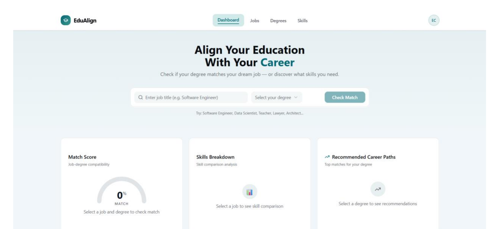
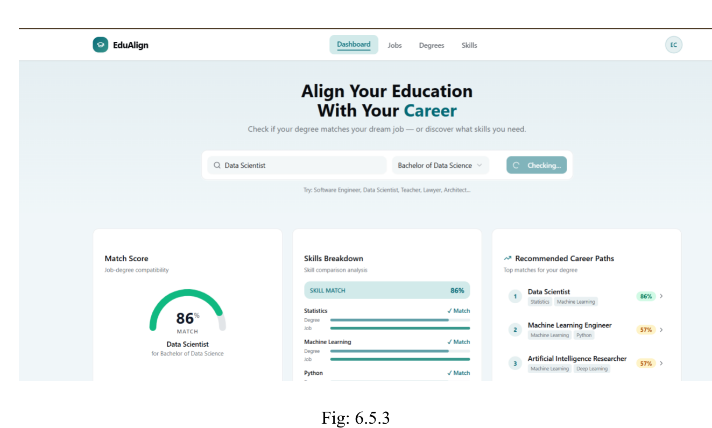

# Dashboard Prototype — "EduAlign"

The academic report documents a companion website prototype (report Figs.
6.5.1–6.5.4) alongside the machine-learning study.

## What it does (as documented)

A user enters a **job title** and selects a **degree**, and the site returns:

- **Match Score** — a job–degree compatibility percentage
  (example shown: Data Scientist × Bachelor of Data Science → **86%**)
- **Skills Breakdown** — per-skill comparison of degree skills vs. job skills
- **Recommended Career Paths** — alternative roles ranked by match
  (e.g. Machine Learning Engineer 57%, Artificial Intelligence Researcher 57%,
  Economist 56%, Public Health Officer 50%)
- Suggested courses for skill gaps, featured job opportunities, and a
  recent-activity list

## Status and honesty notes

- **No source code for this dashboard was included in the academic report**, and
  none was available when this repository was assembled, so this folder contains
  documentation only — no code has been invented to fill it.
- **The dashboard is not described as ML-powered.** Nothing in the report shows
  it calling the trained classification models; its match scores appear to come
  from a built-in degree/job/skills catalogue. It is kept as a separate component
  of the project, exactly as documented.
- If the original dashboard source becomes available, it belongs in this folder,
  and this README should be updated with run instructions.
