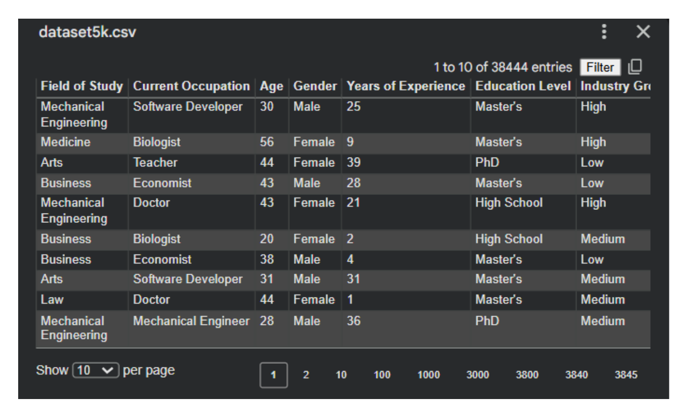

# Dataset

## Status: the original dataset is NOT included in this repository

The academic project loaded a file named **`dataset5k.csv`** (Appendix A of the
report). That file was not part of the submitted report and could not be located
afterwards, so it cannot be published here. No substitute or synthetic dataset is
provided, and none should be mistaken for the original.

To run the pipeline, place a CSV with the schema below at `data/dataset5k.csv`.

## What is known about the dataset (from the report's screenshots)

| Fact | Evidence |
|---|---|
| File name | `dataset5k.csv` (Appendix A code; Fig. 8.1) |
| Shape | 23 columns (Fig. 8.2: "[5 rows x 23 columns]") |
| Rows displayed in the file viewer | 38,444 entries (Fig. 8.1) |
| Rows described in Appendix B text | "approximately 5000 observations" |
| Test-set size in the documented model run | 5,763 rows (Figs. 4.1–4.6), implying ≈ 28,815 rows after `dropna()` at an 80/20 split — inference, not verification |

The row-count question is unresolved; see `PROJECT_REVIEW.md`, section 3.2.

## Documented schema (22 features + target)

Recovered from the feature-importance output (Fig. 6.4.1) and the dataset
screenshots (Figs. 8.1, 8.3.1). Note: Appendix B of the report describes a
different, idealised variable list — see `PROJECT_REVIEW.md`, section 3.6.

| Column | Type | Notes |
|---|---|---|
| Age | numeric | |
| Gender | categorical | e.g. Male / Female |
| Field of Study | categorical | e.g. Mechanical Engineering, Medicine, Arts, Business, Law |
| Current Occupation | categorical | e.g. Software Developer, Doctor, Teacher, Economist |
| Education Level | categorical | High School / Bachelor's / Master's / PhD |
| Years of Experience | numeric | |
| Industry Growth Rate | categorical | Low / Medium / High |
| Job Satisfaction | numeric | strongest documented predictor (importance 0.546) |
| Work-Life Balance | numeric | |
| Job Opportunities | numeric | |
| Salary | numeric | third strongest predictor (0.146) |
| Job Security | numeric | |
| Career Change Interest | numeric | second strongest predictor (0.237) |
| Skills Gap | numeric | |
| Family Influence | categorical | None / Low / Medium / High |
| Mentorship Available | binary | 0/1 |
| Certifications | numeric | count |
| Freelancing Experience | binary | 0/1 |
| Geographic Mobility | binary | 0/1 |
| Professional Networks | numeric | |
| Technology Adoption | numeric | |
| Career Change Events | numeric | count |
| **Likely to Change Occupation** | **target** | binary 0 = No, 1 = Yes |

## Data-quality note

Patterns visible in the report's own screenshots (for example, 25 years of
experience at age 30, and a "High School" education paired with the occupation
"Doctor") indicate the data is synthetically generated rather than collected from
a real survey. Treat modelling results accordingly — see `PROJECT_REVIEW.md`,
section 3.10.
